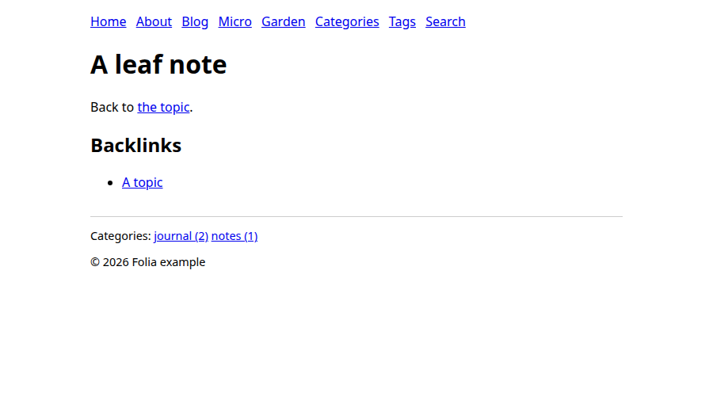

<h1 align="center">
  
</h1>

**A little more joy in publishing.**

Folia is a fast static site generator written in Rust. It turns a git repository of Markdown,
templates and one configuration file into a site you can host anywhere.

> [!IMPORTANT]
> Folia is fully vibe coded: an AI assistant (Claude) writes all of its code, tests, scripts and
> docs, and the maintainer directs and reviews the work. It is tested, not audited, so expect rough
> edges, and it is provided as is, without warranty, under the [MIT license](LICENSE). It was
> started for one website, and you are welcome to use it for yours. The full story is in the
> [disclaimer](DISCLAIMER.md) and [About Folia](docs/about.md).

## Why Folia

I started Folia to replace Jekyll on my own site, [ggirelli.info](https://ggirelli.info), and kept
the parts I wanted: a build that is quick enough to stay out of the way, one coherent workflow from
a Markdown file to a published page, and a site that is plain files in a git repository that you
own. It is not a drop-in Jekyll replacement, and it is not trying to be everything. It is aimed at
people who write a blog, short notes and a digital garden and want one tool for all three.

## Highlights

- **Fast feedback.** `folia serve` builds your site, serves it and rebuilds when a file changes,
  writing only the files that changed and reloading the browser.
- **Markdown content.** Posts, notes and pages are Markdown files with front matter, with syntax
  highlighting and a table of contents when you ask for one.
- **Four collections.** Folia has a blog, a microblog (notes, likes, bookmarks and RSVPs), a
  digital garden with wiki-links and backlinks, and pages with URLs you choose.
- **Templates you control.** Pages are rendered by MiniJinja templates (Jinja-style syntax) that
  you own and edit.
- **The usual outputs.** Atom feeds, a sitemap, search data, redirects, a 404 page and Sass
  compilation, all written for you. Drafts and scheduled posts stay out of a build until you ask.



## Quick start

You need git, because Folia reads each file's last-modified date from its history, and Dart Sass
1.100.0 only if your site has Sass stylesheets. To install Folia, download the Linux x86_64
tarball from the [releases page](https://github.com/ggirelli/folia-web/releases) (not every
release has one yet), or build it with a Rust toolchain:

```sh
cargo install --git https://github.com/ggirelli/folia-web folia --locked
```

Then try the example site, which has one of everything:

```sh
git clone https://github.com/ggirelli/folia-web.git
folia serve --site folia-web/examples/minimal-site     # open http://127.0.0.1:4000/
folia build --site folia-web/examples/minimal-site --dest /tmp/folia-example
```

[Install](docs/getting-started/install.md) has the other ways to install, and
[Your first site](docs/getting-started/first-site.md) makes a site of your own.

## Documentation

The documentation is at <https://ggirelli.github.io/folia-web/>, and in [docs/](docs/index.md):

- [Install](docs/getting-started/install.md) and [Your first site](docs/getting-started/first-site.md)
- [Build and deploy](docs/getting-started/build-and-deploy.md), and the guides to
  [writing content](docs/guide/content.md) and [templates](docs/guide/templates.md)
- The reference: [command line](docs/reference/cli.md),
  [configuration](docs/reference/configuration.md)
- [Migrating from Jekyll](docs/guide/migrating.md) and
  [differences from Jekyll](docs/internals/differences-from-jekyll.md)
- [About Folia](docs/about.md)

## Status and contributing

Folia is pre-1.0 (see the [release notes](docs/release-notes/v0.2.0.md)). The build, `folia serve`,
the four collections and their outputs are what it was made for and are covered by its checks. The
URL prefixes of the collections (`/blog`, `/dg`, `/micro`) are fixed, there are no plugins or
user-defined collections, and some output differs from Jekyll's on purpose or by a known limitation.
Linux x86_64 is the supported platform.

Bug reports and ideas are welcome as [GitHub issues](https://github.com/ggirelli/folia-web/issues).
Changes follow [CONTRIBUTING.md](CONTRIBUTING.md). If Folia is useful to you, you can support its
upkeep through [GitHub Sponsors](https://github.com/sponsors/ggirelli) or
[Ko-fi](https://ko-fi.com/ggirelli); that buys no support, features or warranty.
