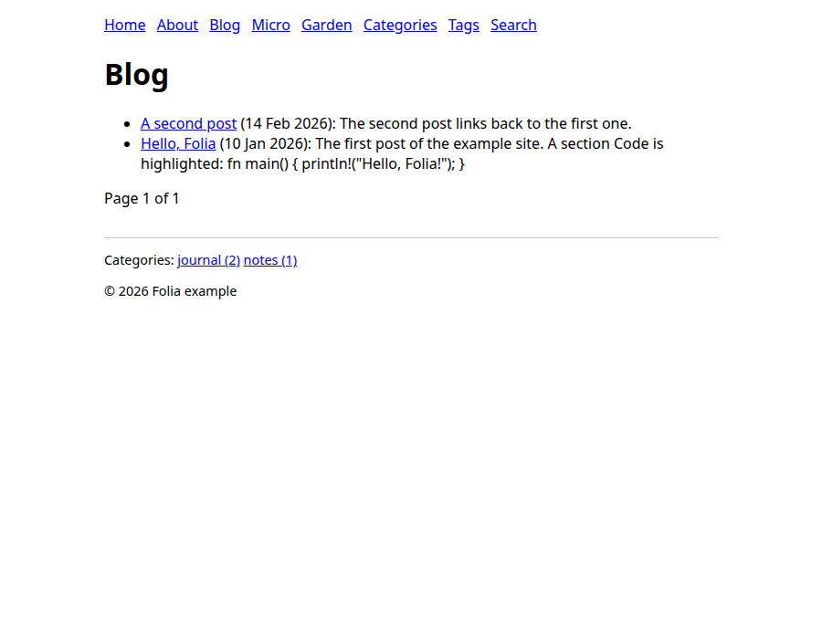
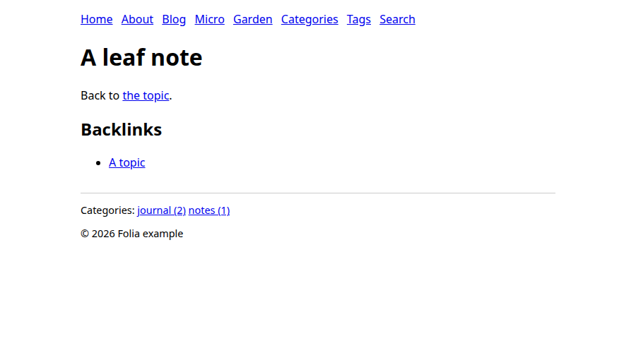

# Your first site

In this tutorial you copy the example site, see it in your browser, change a post and watch the
page update, add a garden note and build the result. It takes a few minutes, and assumes you have
[installed Folia](install.md).

## Copy the example

The repository has a small, complete site in
[`examples/minimal-site`](https://github.com/ggirelli/folia-web/tree/main/examples/minimal-site):
a blog, microblog entries, a digital garden and a few pages: the four collections. Copy it to start
your own, and make it a git repository, because Folia reads dates from git:

```sh
git clone https://github.com/ggirelli/folia-web.git
cp -r folia-web/examples/minimal-site my-site
cd my-site
git init && git add . && git commit -m "First commit"
```

## See it

```sh
folia serve
```

Folia builds the site, prints one warning (the example has a broken wiki-link on purpose) and
serves it at <http://127.0.0.1:4000/>. Open it. The blog at `/blog/` lists the two example posts.



The example's styling is minimal on purpose: the point is the structure, and the look is yours to
write in the templates.

## Change a post

Keep `folia serve` running and open `_posts/2026-01-10-hello-folia.md`. A post is a Markdown file
with front matter, and its file name gives its date and URL:

```markdown
---
title: Hello, Folia
author: ada
categories: [journal]
tags: [folia, rust]
---

The first post of the example site.
```

This file becomes the page `/blog/2026/01/10/hello-folia`. Change the title, save, and watch the
terminal print a line like `[14:03:22] Changed: _posts/2026-01-10-hello-folia.md; building again`.
The page open in your browser reloads. Only the files whose content changed are written, and a
mistake (say, a front matter key Folia does not know) shows over the page and in the terminal
until you fix it.

## Add a garden note

The garden lives in `_garden/`, and its notes link to each other by
title. Make `_garden/topic/new.md`:

```markdown
---
title: A new note
date: 2026-03-01
---

This note points back to [[A leaf note]].
```

Save it and open <http://127.0.0.1:4000/dg/topic/new>. Then open the note it names,
`/dg/topic/leaf`: the new note is listed under its backlinks, without you editing the leaf note.



## Build it

Stop `folia serve` with Ctrl+C. To produce the site you publish, use `folia build`, which needs a
destination outside the site:

```sh
folia build --dest ../my-site-out
```

It prints the warning again and a summary, `Built 18 pages, …` (the counts grow with what you add).
`../my-site-out` now holds plain files: `blog/`, `dg/`, `feed.xml`, `sitemap.xml`, and so on. Upload
them to any static host.

A note on the two commands: `folia serve` builds into your cache directory and sets the site's URL
to the local address, so use it to write and `folia build` to publish. Its links are root-relative
(`/about`), so open the build through a server that maps clean URLs, as your host does, rather than
as files.

## How the site is laid out

Now that you have seen it work, here is what you copied:

```text
my-site/
  _folia/
    folia.toml          the configuration: where things are, who writes, feeds, search
    templates/          the page templates (MiniJinja)
    search/search.js    the code of the search script, if the site has search
  _posts/               blog posts: 2026-01-10-hello.md
  _micro/{notes,likes,bookmarks,rsvps}/    microblog entries
  _garden/              garden notes, in any folders you like
  about.md, index.md    pages: any other file with front matter
  assets/               static files, copied as they are
```

The directory names `_posts`, `_micro` and `_garden` are the example's: you name them in the
configuration's `[roots]`. From here:

- [Writing content](../guide/content.md): the files and their front matter.
- [Templates](../guide/templates.md): what each template can use.
- [Configuration reference](../reference/configuration.md): every key of `folia.toml`.
- [Build and deploy](build-and-deploy.md): the destination, Sass and a CI recipe, then the
  [command-line reference](../reference/cli.md) for the exit status.
